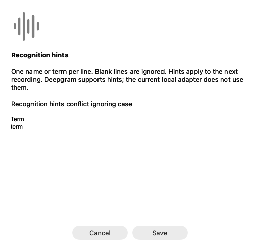
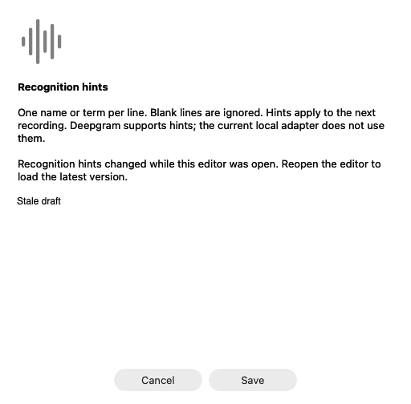
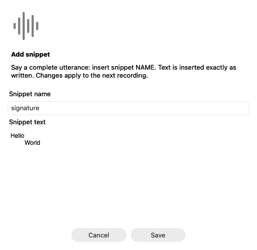
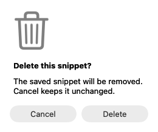

# Personal vocabulary, language and snippets (#9)

Murmur reads `~/Library/Application Support/Murmur/vocabulary.json` once before
each utterance, before credentials or microphone startup. Changes apply to the
next utterance. Missing files mean an empty English profile; malformed files refuse the
attempt instead of silently losing settings. The native completion/generation,
focus and cancellation checks still control insertion.

Generate and validate a profile, edit it, then import it explicitly:

```sh
murmur vocabulary example vocabulary.json
murmur vocabulary validate vocabulary.json
murmur vocabulary import vocabulary.json
murmur vocabulary export vocabulary-backup.json
```

These commands do not capture audio. Example/export write the named file; import
replaces the app's profile atomically only after complete validation. The schema
has no credential/provider-endpoint fields. It can contain personal vocabulary
and snippet text, so handle exported profiles accordingly. `doctor` reports
counts, the selected language and capability limitations without printing hints or snippets.

```json
{
  "version": 1,
  "language": "en",
  "recognition_hints": ["Project Acorn", "C++", "Zoë & Sons"],
  "snippets": [
    {"name": "sign off", "text": "Thanks,\nExample team"}
  ]
}
```

Recognition hints become repeated, percent-encoded Nova-3 `keyterm` parameters.
They are recognition hints, not deterministic text substitutions. Cloud retries
use the same immutable list. Snippet bodies never enter recognition prompts.
Deepgram documents a [500-token keyterm limit](https://developers.deepgram.com/docs/keyterm).
Murmur imposes a conservative separate limit of 500 UTF-8 bytes including one
separator per hint, at most 64 hints, and 128 bytes per hint; it does not claim
to reproduce Deepgram's tokenizer. Empty/untrimmed/control-containing or
case-insensitive duplicate hints are refused.

Local Whisper does not implement Nova-3 keyterms. It receives no hints and never
contacts a hosted model to repair them. The native progress label and successful
completion message explicitly report this difference when hints are configured.
Deterministic snippets still apply to the winning local transcript.

Say a complete utterance such as **"insert snippet sign off"** to expand a
snippet. Matching ignores case and surrounding whitespace and allows one final
`.`, `!` or `?`. It does not expand a cue embedded in a sentence, repeated cues,
unknown names, plurals, or quoted code. There are no global word replacements.
Names contain letters/numbers, single spaces, hyphens or underscores, are at
most 80 UTF-8 bytes, and must be unique ignoring case. Snippet text is preserved
verbatim, including newlines/tabs; other control characters are refused. Limits:
128 snippets, 16 KiB per body and 256 KiB per serialized profile. Unsupported
versions, unknown fields, conflicting names and oversized inputs are rejected
before replacing existing settings.

## Evidence and remaining scope

The first behavioral tests failed because the scaffold left cues unchanged,
accepted unsupported versions and overwrote prior settings on invalid save.
Tests now cover exact boundaries, accented Unicode, overlapping names, prose and
code preservation, size limits, atomic failure, CLI example/validation, request
encoding, identical hints across cloud retry, and local capability reporting.
A real capture-path fixture changes the on-disk profile during transcription and
verifies that only the winning final is expanded with the original snapshot.
An invalid profile never starts the fixture microphone.

Run the focused tests, plus the formatting, Clippy and workspace checks in
CONTRIBUTING.md:

```sh
cargo test --locked --test vocabulary --test streaming --test fallback --test capture
```

All test audio/text and credentials are synthetic.

This is partial delivery of #9. Explicit language selection and client-side
preflight/binding and the managed language adapter are implemented below.
The native language menu is implemented; vocabulary editing UI and real speech acceptance remain open.
Real-model term-recall comparisons (#118), native dictation/insertion checks and
full vocabulary editing UI remain unverified. Do not claim recognition-quality
improvement from transport tests. Optional AI cleanup (#8) is separate and has
not been enabled by this change.

## Explicit language selection

Choose **Language** in the menu bar to select a common language directly or find
another choice in the alphabetical groups. The title and checkmark show the saved
choice. Regional codes are retained explicitly (for example French `fr-CA`). The
catalog includes local and cloud choices; actual provider/model support is still
checked before capture. A malformed profile is shown as needing attention and
cannot be overwritten by choosing a language. CLI/import changes refresh in the
menu on the next periodic UI update (after menu tracking ends, if it is open).

`murmur language es` also persists Spanish in the same version-1 profile. It applies
to the next utterance without restarting the app. Language also survives profile
import/export. Older profiles without the field default to `en`. Use canonical
codes such as `en`, `es`, `fr-CA`; malformed tags fail without replacing settings.
Automatic detection and code-switching are not implied by this setting.

Before starting the microphone, cloud modes check the selected code against the
[Nova-3 monolingual language table](https://developers.deepgram.com/docs/models-languages-overview#nova-3)
(verified 2026-10-24). Both cloud attempts receive the same explicit `language`
parameter and recognition hints from the utterance snapshot. No alternate cloud
model or language is silently substituted.

Local modes check the engine's language/model capabilities before recording.
The managed helper reports the loaded model's languages and enforces the
[capability contract](local-language-contract.md). Its default base.en model
supports English only; explicitly import a multilingual GGML model while stopped
and restart the helper before selecting another supported language. No model is
downloaded during capture. Plain external whisper.cpp servers report readiness
only, so non-English requests to those endpoints are refused before capture,
even if the filename suggests a multilingual model.

For a capability-aware adapter, the prepared endpoint carries the selected
language, model SHA and serving instance ID through capture and fallback.
Inference sends explicit language, translation=false and detection=false.
Missing/different response identities refuse insertion. Local recognition hints
remain unsupported; they are omitted with the existing visible notice.

Language RED/GREEN: the capture fixture selected Spanish but the actual cloud
handshake omitted language; it now sends Spanish while an on-disk edit to French
only affects the next utterance. Tests cover language/profile roundtrip, legacy
English defaults, invalid-write preservation, identical French on both cloud
attempts and local fallback, and refusal before microphone start for unknown
cloud codes and unverifiable local/fallback language. Loopback fixtures verify
bounded capability parsing, unsupported/malformed capabilities, explicit local
wire settings, and rejection of changed/missing runtime/model identities. These
are transport/lifecycle tests. The managed adapter additionally passed real-engine
synthetic English/French smoke checks; human multilingual accuracy remains a
separate evaluation.

## Native language menu evidence

Behavioral RED: a menu-selection scaffold left the saved language as English and
accepted an invalid language. GREEN: the shared save operation validates, reloads
the latest profile and changes only language, preserving vocabulary/snippet edits
made since the menu opened. An active utterance retains its original snapshot.
Tests also preserve malformed profiles and cover the common/local/regional
catalog without duplicates. CLI language selection uses the same operation.

An isolated native preview on 2026-10-24 exercised the actual menu component with
an explicit temporary profile, no input tap, microphone, credentials or user
settings. Accessibility actions selected French and French (Canada), preserved a
newer external vocabulary edit, verified the native checkmark after selecting the
same language again, and verified that an invalid profile stayed byte-for-byte
unchanged after a menu choice. An external Japanese selection appeared in the
menu. The preview and temporary profile were removed. This does not replace the
signed app's remaining microphone/hotkey/insertion or permission acceptance.

The isolated harness is `cargo run --example language_menu_preview --
/absolute/path/to/fixture-profile.json` on macOS. It only edits that supplied file.


## Native editing

The Murmur menu contains Language and Vocabulary and Snippets. Recognition hints
use one term per line; Add snippet and Edit snippets provide a name plus multiline
text. Save validates before replacing the profile, Cancel leaves the saved file
unchanged, and deletion requires a separate confirmation. Hints are advertised
for Deepgram; the current local adapter does not consume them. Changes apply to
the next recording, including the selected language.

Editing is available while dictation is idle. Opening or closing an editor clears
pending shortcut work, so an earlier held/quick shortcut cannot start or replay
when the dialog closes. Native Edit menu actions remain available to the form.

Field-scoped saves preserve unrelated language/hint/snippet edits, refuse a draft
whose own field changed, and use a nonblocking profile lock shared with CLI imports
and language selection. A stale draft or busy writer displays an inline error;
Cancel preserves both the saved profile and any external edits. Corrupt profiles
are preserved and reported instead of being replaced with defaults.

`cargo run --locked --example vocabulary_native_qa -- /absolute/new-fixture-directory`
runs real AppKit modal button actions against a synthetic profile, without Shell,
permissions, capture, global input or clipboard access. It checks native language
checkmarks, Save/Cancel, invalid/locked/stale errors, exact multiline snippet text,
and confirmed/cancelled deletion. Mac CI runs it with a 40-second process deadline
and uploads the owned view renders. The runner refuses an existing output directory.
It fixes only its own app's appearance for deterministic bitmap renders; system
appearance is unchanged. The native windows remain transparent during the run.

Two fresh runtime regressions first showed an unlocked writer replacing settings
under a held lock, and a suspended shortcut starting after editor closure. The
core tests now cover both, with bounded lock acknowledgment to avoid hanging CI.
Native interaction/IME and full signed-app microphone/hotkey/insertion checks still
need physical acceptance. These fixtures do not claim that broader acceptance.


Owned AppKit renders (fixed light appearance, synthetic values):





